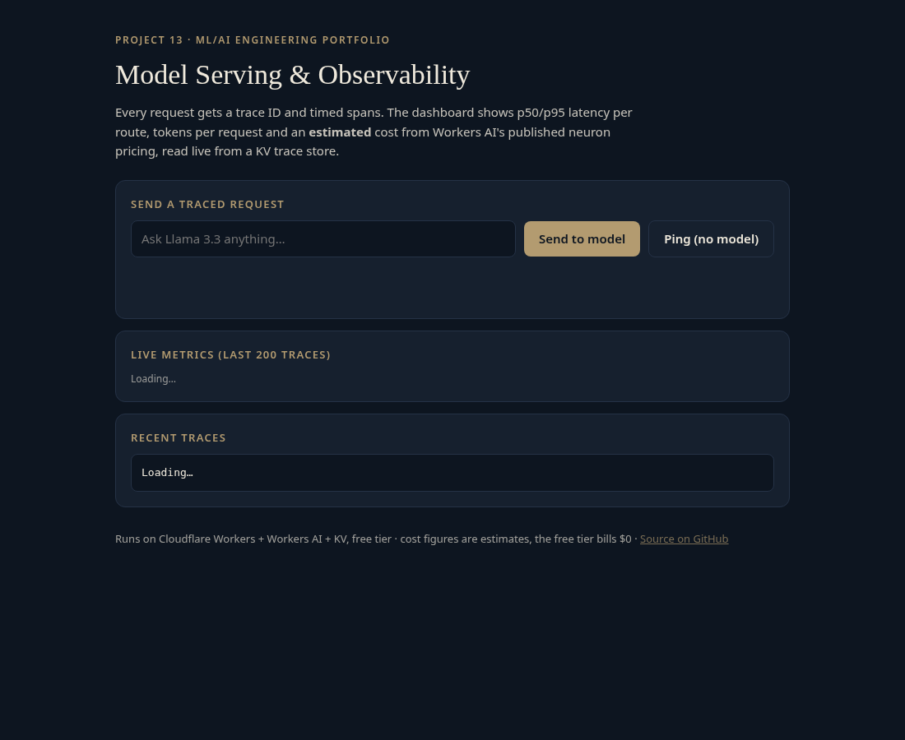
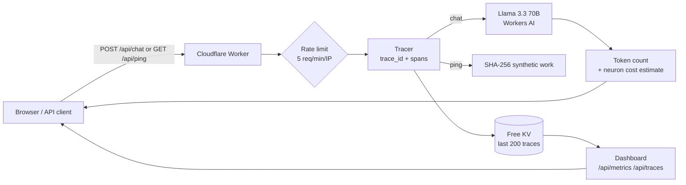

# agent-13-serving-observability

Model serving with per-request observability: trace IDs, timed spans, latency p50/p95, tokens and an **estimated** cost from published Workers AI neuron pricing, stored in free Cloudflare KV and shown on a live dashboard. Project 13 of an ML/AI engineering portfolio.

**Live demo:** https://agent-13-serving-observability.braylo777.workers.dev



## What it is
Every `/api/chat` (Workers AI) and `/api/ping` (no model) request gets a 32-hex trace ID and a span tree (`rate_limit` → `build_prompt` → `model.generate`, or `work.hash`). Traces land in a free KV namespace (last 200). The dashboard and `/api/metrics` report p50/p95, average tokens in/out and estimated USD per request.

## Architecture


## Cost estimate (labelled)
Published pricing for `@cf/meta/llama-3.3-70b-instruct-fp8-fast` (Cloudflare Workers AI pricing page, read Oct 27, 2026):

| Direction | Neurons / M tokens | USD / M tokens |
|---|---|---|
| Input | 26,668 | $0.293 |
| Output | 204,805 | $2.253 |

USD = neurons / 1,000 × $0.011. The free tier includes 10,000 neurons/day at $0 — the estimate is what the same usage would cost above the free allocation. Prefer the model's `usage` block when present; otherwise fall back to ≈4 chars/token and label the source.

## Eval results
### Synthetic `/api/ping` load (no Workers AI)
Run after deploy: `node evals/run-synthetic.mjs`. Writes [`evals/results.json`](evals/results.json).

| Metric | Result | Definition |
|---|---|---|
| Client latency p50 / p95 | **28 ms / 63 ms** (n=40) | End-to-end `/api/ping` from the eval client |
| Unique trace IDs | **40/40** | Distinct 32-hex IDs across the run |
| Server-reported `/api/ping` | n=14, errors=0, p50=0 ms, p95=0 ms | From `/api/metrics` after the load (KV window; concurrent writers may under-count) |

### Live `/api/chat` (Workers AI) — **not yet run**
Workers AI free daily neuron quota is exhausted until ~7 PM CT Oct 28. Rerun:

```bash
BASE=https://agent-13-serving-observability.braylo777.workers.dev node evals/run-chat.mjs
```

That script records per-request latency, tokens, cost estimate and span names for 20 prompts (throttled to the demo's 5 req/min limit).

## Tests
11 offline unit tests (`node:test`, Workers AI + KV mocked): trace ID format, span timing/errors, published-price cost math, percentiles, token fallback, summarize-by-route, KV cap at 200, HTTP chat with usage / without usage / 502, validation, rate limit, ping and 404.

```bash
npm test
```

## Run it
```bash
npm install
npm test
npx wrangler dev     # needs a TRACES KV binding
npx wrangler deploy  # free tier
node evals/run-synthetic.mjs   # no model
node evals/run-chat.mjs        # needs Workers AI quota
```

## Stack
Cloudflare Workers · Workers AI (Llama 3.3 70B) · Workers KV · vanilla JS · node:test

## License
MIT

## How to run

```bash
npm install   # dev deps only
npm test      # 15 offline tests, no Workers AI calls
npm run dev   # local wrangler dev
```

## Test results (2026-10-27)

| Suite | Tests | Status |
|---|---|---|
| Unit + edge cases (test/edge.test.js added) | 11→15 | all pass |
| Live demo https://agent-13-serving-observability.braylo777.workers.dev | HTTP 200 | verified 2026-10-27 |
