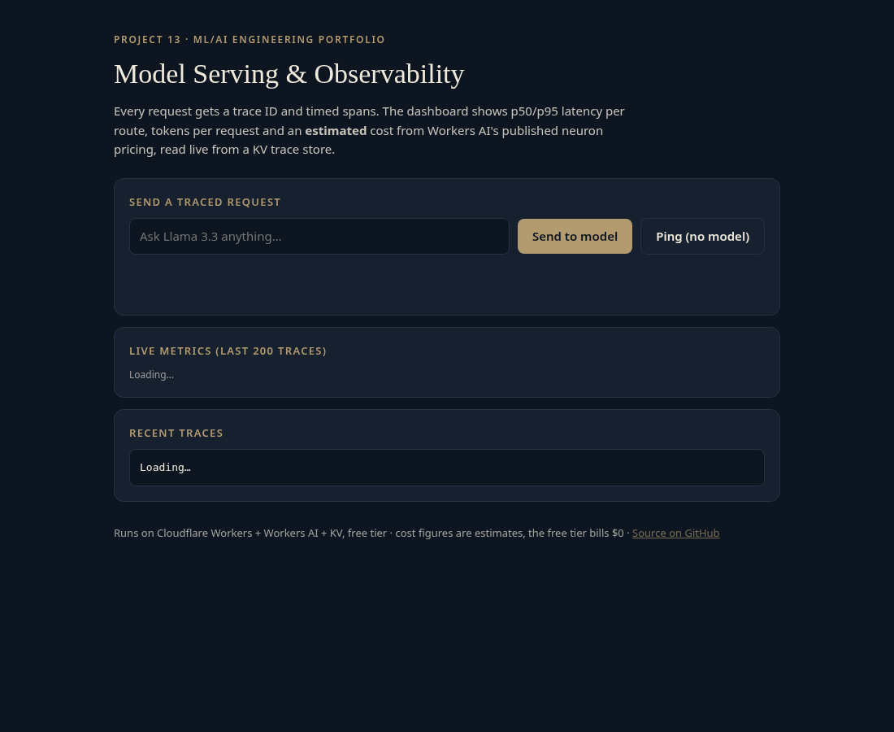
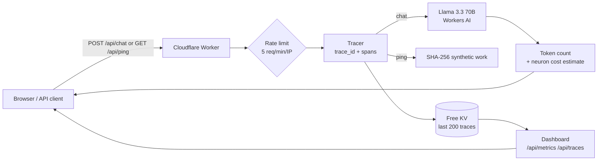

# agent-13-serving-observability

Model serving with per-request observability: trace IDs, timed spans, latency p50/p95, tokens and an **estimated** cost from published Workers AI neuron pricing, stored in free Cloudflare KV and shown on a live dashboard. Project 13 of an ML/AI engineering portfolio.

**Live demo:** https://agent-13-serving-observability.braylo777.workers.dev



## What it is
Every `/api/chat` (Workers AI) and `/api/ping` (no model) request gets a 32-hex trace ID and a span tree (`rate_limit` → `build_prompt` → `model.generate`, or `work.hash`). Traces land in a free KV namespace (last 200). The dashboard and `/api/metrics` report p50/p95, average tokens in/out and estimated USD per request.

## Architecture


## Cost estimate (labelled)
Published pricing for `@cf/meta/llama-3.3-70b-instruct-fp8-fast` (Cloudflare Workers AI pricing page, read Oct 27, 2026):

| Direction | Neurons / M tokens | USD / M tokens |
|---|---|---|
| Input | 26,668 | $0.293 |
| Output | 204,805 | $2.253 |

USD = neurons / 1,000 × $0.011. The free tier includes 10,000 neurons/day at $0 — the estimate is what the same usage would cost above the free allocation. Prefer the model's `usage` block when present; otherwise fall back to ≈4 chars/token and label the source.

## Eval results
### Synthetic `/api/ping` load (no Workers AI)
Run after deploy: `python3 evals/run_synthetic.py`. Writes [`evals/results.json`](evals/results.json).

| Metric | Result | Definition |
|---|---|---|
| Client latency p50 / p95 | **28 ms / 63 ms** (n=40) | End-to-end `/api/ping` from the eval client |
| Unique trace IDs | **40/40** | Distinct 32-hex IDs across the run |
| Server-reported `/api/ping` | n=14, errors=0, p50=0 ms, p95=0 ms | From `/api/metrics` after the load (KV window; concurrent writers may under-count) |

### Live `/api/chat` (Workers AI) — **not yet run**
Workers AI free daily neuron quota is exhausted until ~7 PM CT Oct 28. Rerun:

```bash
BASE=https://agent-13-serving-observability.braylo777.workers.dev python3 evals/run_chat.py
```

That script records per-request latency, tokens, cost estimate and span names for 20 prompts (throttled to the demo's 5 req/min limit).

## Tests
Python: 8 test functions; Rust: 4 test functions (Workers AI, KV, clock and rate limiter mocked behind a `Host` trait): trace ID format, span timing and errors, published-price cost math, percentiles, token fallback, summarize-by-route, the 200-trace KV cap, and the HTTP routes (chat, fallback, 502 with a stored error trace, 400, 429, ping, 404). Cost estimates, span timings, summaries, percentiles and the KV store give identical output for the old JavaScript, the Python and the Rust code on a shared scenario (13 cost inputs, 4 serve variants, 205 stored traces).

```bash
python3 -m pytest
cd worker && cargo test
```

## Run it
```bash
python3 -m pytest                       # Python tests
cd worker && cargo test                 # Rust tests
cd worker && worker-build --release     # build the Worker (wasm)
wrangler dev                            # needs a TRACES KV binding
wrangler deploy                         # free tier
python3 evals/run_synthetic.py          # no model
python3 evals/run_chat.py               # needs Workers AI quota
```

The previous JavaScript version is on the `legacy-js` branch and the `pre-pycrust` tag.

## Stack
Cloudflare Workers (Rust, workers-rs) · Workers AI (Llama 3.3 70B) · Workers KV · Python (pytest)

## License
MIT
